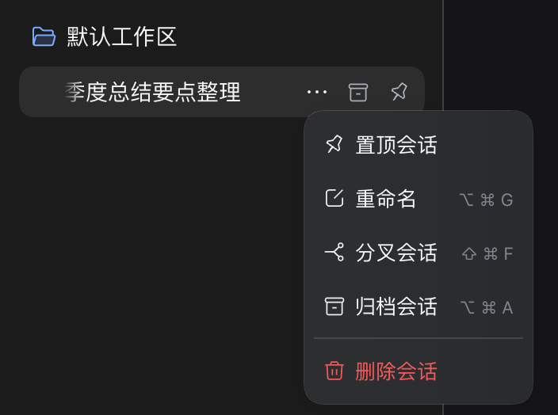
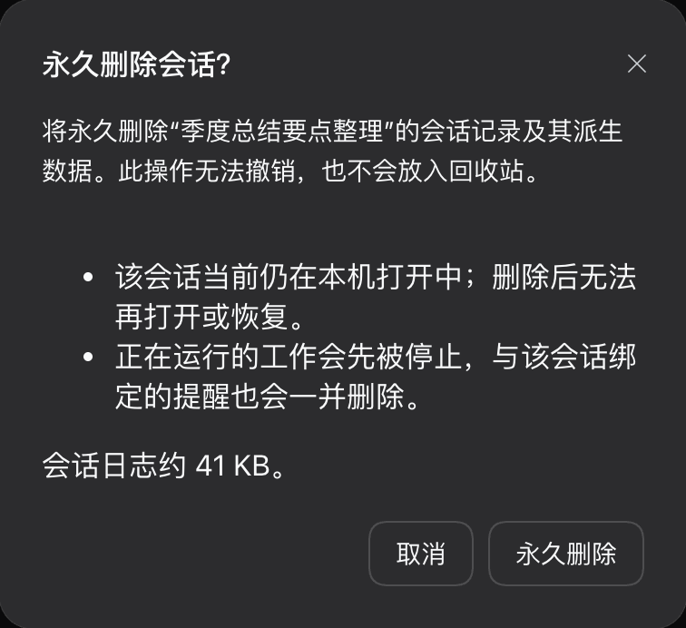

# dsh-tool-session-delete

[English](README.md) | 中文

[](https://www.npmjs.com/package/dsh-tool-session-delete)
[](LICENSE)
[](https://github.com/Jaylor-Wang/dsh-tool-session-delete/releases)

**DeepSeek Harness (DSH) 侧边栏永久彻底删除会话插件**，并在删除前提供详尽的状态与日志占用确认弹窗。

DSH 原生自带的「归档」（Archive）是可逆操作，会将记录保存在归档列表中。本插件为侧边栏补充了彻底删除功能。与普通的 `rm` 删除日志不同，本插件深入解绑内存活体与注册表，真正让已删会话从侧边栏与磁盘中永久消失，杜绝复活与死锁。



## 功能特点

在左侧边栏每个会话条目的 `…` 菜单中增加一项 **「删除会话」**（排序在置顶 / 重命名 / 分叉 / 归档之后）。点击后会弹出确认模态框，详细展示：

- 该会话**是否仍在本机处于打开/驻留状态**（删除后无法再打开或恢复）；
- 即将被移除的**磁盘日志实际大小**；
- 绑定到该会话的**进行中轮次（turns）、子智能体（subagents）、后台任务（jobs）与定时提醒（schedules）**；
- 会一并删除多少个绑定的定时提醒。



点击「永久删除」后，系统会平稳停止会话工作，删除其会话磁盘目录与投影快照缓存（`session_projcache`），并从所有活跃与持久化注册表中释放该 ID。随后侧边栏平滑刷新，会话条目彻底消失。

**操作不可逆，且不会放入回收站**。

## 为什么不仅是简单的 `rm`

在 DSH 中，会话不仅仅是由磁盘上的目录定义的。Host 端的会话池是由 `persistence ∪ live`（持久化数据与内存活跃实例的并集）构成的。因此，如果仅在磁盘上删除了文件，Host 内存中仍然驻留该会话的活跃实例，它就会在刷新时“死而复生”：

1. 浏览器临时移除了该条目；
2. 随后的 `sessions.refresh()` 从 Host 重新拉取会话列表，并将内存活跃实例折叠回列表中；
3. **已删条目再次复活**。

这导致的典型现象是：连续删除多个会话时，先前删除的会话会重新冒出；或者被删除的会话 ID 永久堆积在 `workspace.json` 的归档列表中成为死引用。

本插件的 `release()` 严格遵循宿主 Fiber 的解绑顺序：
- **先解绑 Agents，再解绑 Sessions**（防止 `agent/disposed` 意外反向重新广播 `api-session/added`）；
- 从工作区归档集合中调用 `unarchiveSession(id)` 并解除置顶 `unpinSession(id)`；
- 从当前工作区调用 `workspace.detachSession(id)`；
- 针对 Windows 文件锁与反病毒软件扫描，内置退避重试（`rmWithRetry`）与延迟落盘缓冲（`STOP_SETTLE_MS`），杜绝 `EBUSY / EPERM` 报错。

浏览器端同时维护 `retired` 集合，在每次列表刷新后自动补全移除，确保界面平滑、零复活、零闪烁。

## 安装指南

本插件遵循标准的 `dsh.bundle` 清单规范，`dsh plugin` 会自动将其装载为 profile 层，**无需手动修改 `cordis.patch.yml`**。宿主会自动解析所需的 `@deepseek-ai/*` 依赖，因此本插件自身为 **0 运行时依赖**。

```bash
# 推荐：通过 DSH 插件命令安装
dsh plugin --profile web add dsh-tool-session-delete

# 或通过 npm / pnpm 安装
npm install dsh-tool-session-delete
pnpm add dsh-tool-session-delete
```

若是本地源码调试，也可使用 `file:` 路径：

```bash
dsh plugin --profile web add file:/path/to/dsh-tool-session-delete
```

验证插件是否已成功合入配置树（必须出现在插件自带的 banner 标识下方）：

```bash
dsh --profile <profile> --dump-config | grep -B1 tool-session-delete
```

```yaml
# == …/dsh-tool-session-delete/cordis.patch.yml
- id: tool-session-delete
  name: dsh-tool-session-delete
```

最后**重启 Harness**：

```bash
dsh web
```

## 设计亮点

- **采用 Typert `Remote` 原生 RPC 协议，而非 HTTP 路由**：Host 端注册为 `sessionDelete` 远程服务（提供 `describe` 与 `deleteSession` 接口）。Gateway 自动声明并通过 `/api` WebSocket RPC 信道通信。因此**天然适配 Web 与 Electron 桌面客户端**，绝不会因 Origin 拦截报 403 权限错误。
- **磁盘物理删除实测探测**：删除目录后，插件会主动通过 `stat` 验证文件是否确实已从磁盘消失。若遇 Windows 文件占用等导致删除失败，会显式向前端抛出提示，绝不假装成功。
- **投影缓存同步清理**：除删除会话目录外，还会一并清除 `storageDomain("session_projcache")` 中的快照，不留任何脏数据。

## 多语言支持

插件内部自带完整的**简体中文（`zh`）**与**英文（`en`）**双语字典，语言会跟随 DSH 客户端界面设置自动切换，开箱即用。

## 许可证

[MIT](LICENSE) © [Jaylor-Wang](LICENSE)
